<div align="center">

<a href="https://barclayleach.com/en/"></a>

<br/>

[](https://barclayleach.com/en/)
[](https://www.cernextec.com)

[](https://www.linkedin.com/in/barclay-leach)
[](https://wa.me/51988490319)
[](mailto:bclaydrius@gmail.com)
[](https://www.instagram.com/barclayleach)
[](https://www.tiktok.com/@barclayleach_)


</div>

<br/>

<p align="center">
  <picture>
    <source media="(prefers-color-scheme: dark)" srcset="./assets/headings/h-now-dark.svg">
    
  </picture>
</p>

I build websites, platforms and funnels whose one job is to **bring in customers** — and I keep the whole portfolio public, so anyone can open the work and check it. I founded **[Cernext](https://www.cernextec.com)**, a digital agency & consultancy where a small team handles web, video, Meta Ads, CRM/ERP and AI chatbots under one roof, and I lead technology at **[IDI Adonai](https://idiadonai.com)**. Before that, I spent most of 2026 as a professional EN/ES interpreter on medical, legal and financial calls — so translating what a business needs into software that ships comes naturally.

<div align="center">

| | Role | Where | When |
|:-:|------|-------|------|
| 🚀 | **Founder** | [Cernext](https://www.cernextec.com) — Agency & Digital Consultancy | 2025 — now |
| 🛰️ | **CTO** | [IDI Adonai](https://idiadonai.com) — satellite & drone consultancy · built their site + CRM | 2026 — now |
| 🎬 | **Web Systems & Infrastructure Lead** | [KetBia](https://www.ketbia.com) — UGC & ads for brands | 2026 — now |
| 🎧 | Bilingual Interpreter (EN ⇄ ES) | LanguageLine Solutions · via Teleperformance | Feb — Oct 2026 |
| 🎓 | Systems & Computer Engineering | Universidad Continental | in progress |

</div>

```typescript
const barclay = {
  based: "Lima, Perú 🇵🇪",
  now: ["Founder @ Cernext", "CTO @ IDI Adonai", "Web Systems Lead @ KetBia"],
  ships: ["websites that sell", "CRMs & internal systems", "AI chatbots", "funnels"],
  stack: {
    front: ["TypeScript", "React 19", "Next.js 16", "Astro 6", "GSAP", "Motion", "Lenis"],
    back: ["Node.js", "Supabase", "PostgreSQL", "PHP"],
    edge: ["Cloudflare Workers", "Vercel"],
    mobile: ["React Native", "Expo"],
  },
  growth: ["Technical SEO", "Google Ads", "Meta Ads", "Meta Conversions API", "WhatsApp"],
  speaks: { es: "native", en: "native · C2", pt: "working", ja: "学習中" },
  motto: "Bench-press your code, optimize your life.",
};
```

<br/>

<p align="center">
  <picture>
    <source media="(prefers-color-scheme: dark)" srcset="./assets/headings/h-featured-dark.svg">
    
  </picture>
</p>

<p align="center">
  <a href="https://barclayleach.com/en/portfolio/">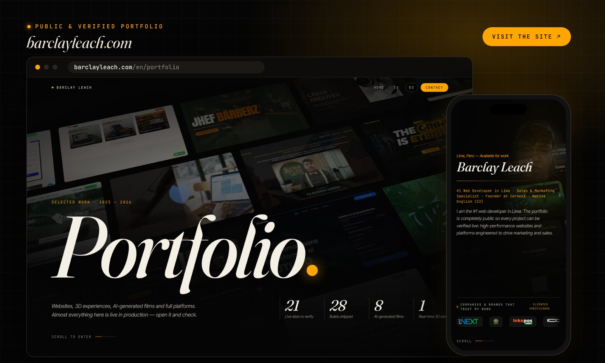</a>
</p>

<p align="center">
  <a href="https://barclayleach.com/en/portfolio/"></a>
</p>

<div align="center">

My portfolio is **100% public**: real sites in production, scrollytelling, 3D, AI-generated films and full platforms — open any project and check it live.

[](https://barclayleach.com/en/)
[](https://barclayleach.com/en/portfolio/)
[](https://barclayleach.com/en/about-me/)
[](https://barclayleach.com/en/cv/)
[](https://barclayleach.com/es/)

</div>

<br/>

<p align="center">
  <picture>
    <source media="(prefers-color-scheme: dark)" srcset="./assets/headings/h-work-dark.svg">
    
  </picture>
</p>

<table>
<tr>
<td width="50%" valign="top">
<a href="https://www.cernextec.com">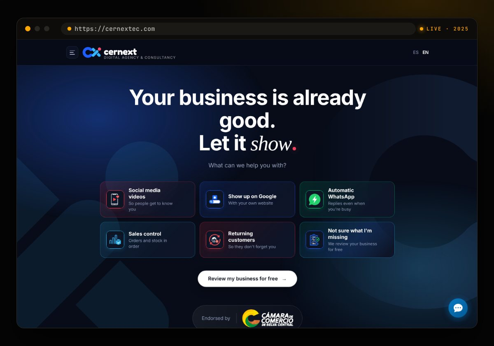</a>
<h3>Cernext <sub><sup>2025</sup></sub></h3>
My agency's platform — web, video, ads, CRM/ERP and AI chatbots under one roof.<br/><br/>
<code>Next.js 16</code> <code>React 19</code> <code>Supabase</code> <code>Tailwind v4</code> <code>Meta CAPI</code>
</td>
<td width="50%" valign="top">
<a href="https://idiadonai.com">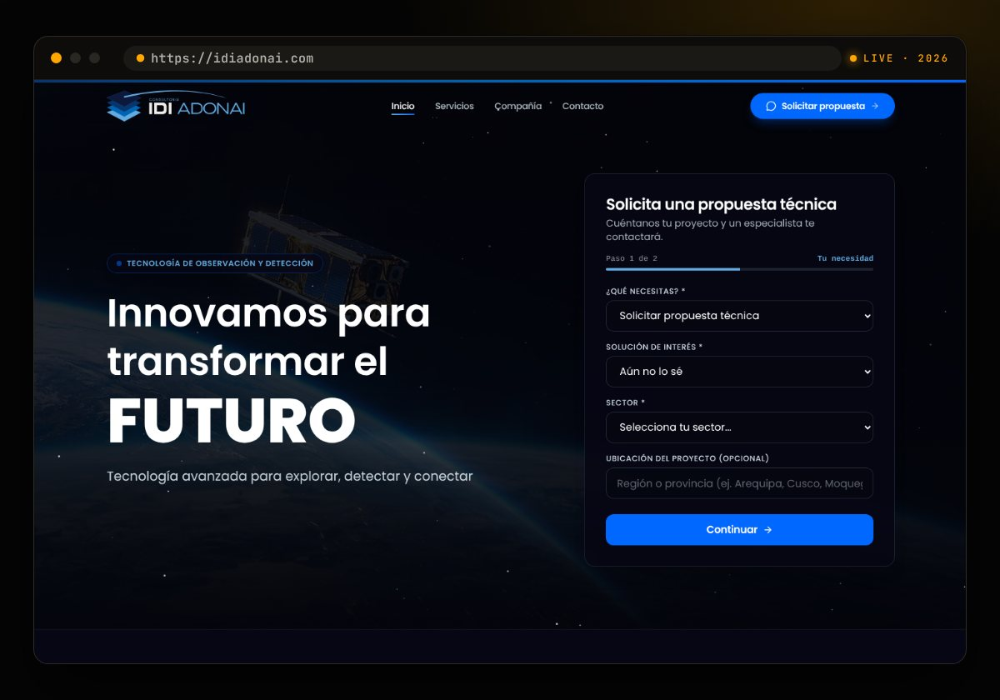</a>
<h3>IDI Adonai <sub><sup>2026</sup></sub></h3>
Satellite &amp; drone consultancy — lead-gen site with a multi-step technical quote form.<br/><br/>
<code>React 19</code> <code>TypeScript</code> <code>GSAP</code> <code>Tailwind</code> <code>SEO</code>
</td>
</tr>
<tr>
<td width="50%" valign="top">
<a href="https://iconic-motos.com/">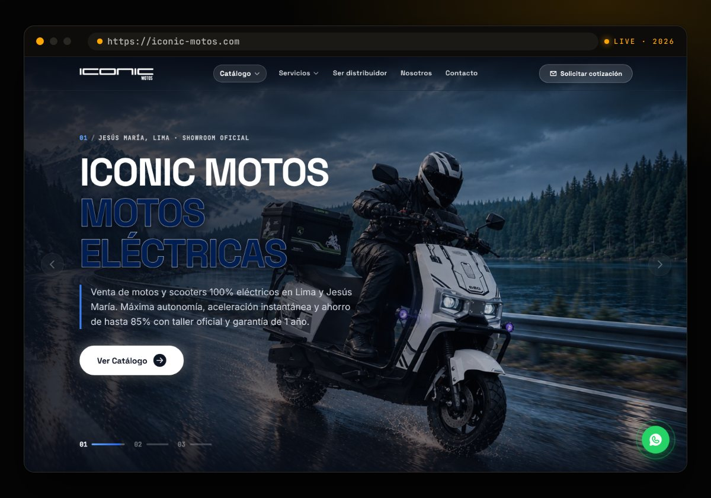</a>
<h3>Iconic Motos <sub><sup>2026</sup></sub></h3>
Electric motorcycle &amp; scooter dealer in Lima — catalog, showroom and quote flow.<br/><br/>
<code>Astro 6</code> <code>React 19</code> <code>Motion</code> <code>Cloudflare</code>
</td>
<td width="50%" valign="top">
<a href="https://paris-xpress.com/">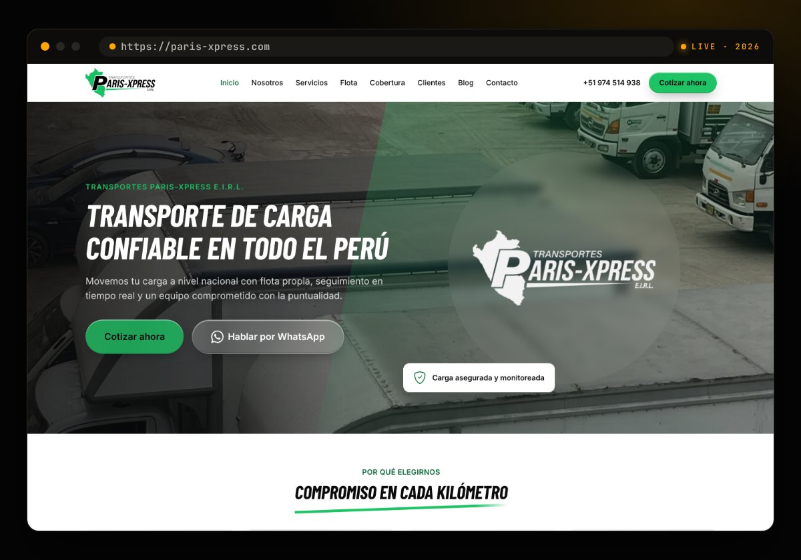</a>
<h3>Paris-Xpress <sub><sup>2026</sup></sub></h3>
Nationwide freight transport — fleet, coverage and instant quotes over WhatsApp.<br/><br/>
<code>Astro</code> <code>React 19</code> <code>Tailwind v4</code> <code>Motion</code> <code>CF Workers</code>
</td>
</tr>
<tr>
<td width="50%" valign="top">
<a href="https://baronclub.es/">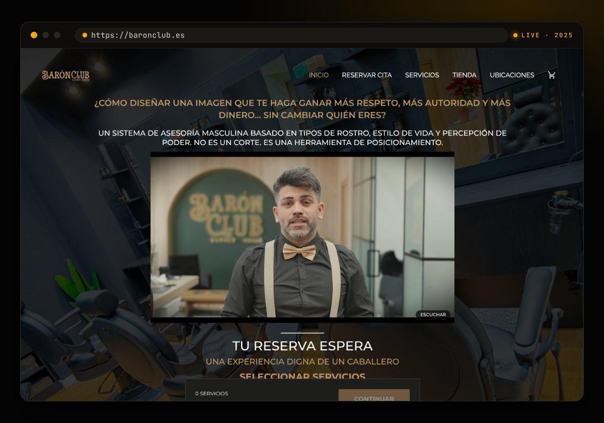</a>
<h3>Barón Club <sub><sup>2025 · 🇪🇸</sup></sub></h3>
Premium barbershops in Valencia, Spain — custom booking plugin, Telegram alerts and paid media.<br/><br/>
<code>WordPress</code> <code>PHP</code> <code>Telegram Bot API</code> <code>Google Ads</code> <code>Meta Ads</code>
</td>
<td width="50%" valign="top">
<a href="https://www.ketbia.com/">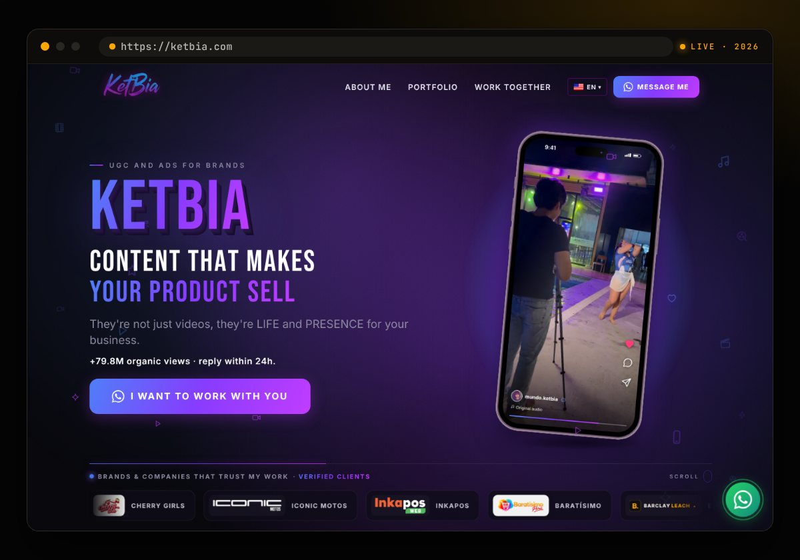</a>
<h3>KetBia <sub><sup>2026</sup></sub></h3>
UGC &amp; ads studio for brands — systems, payments and infrastructure.<br/><br/>
<code>React</code> <code>Node.js</code> <code>Payment gateway</code> <code>SEO</code>
</td>
</tr>
<tr>
<td width="50%" valign="top">
<a href="https://tayoton.com">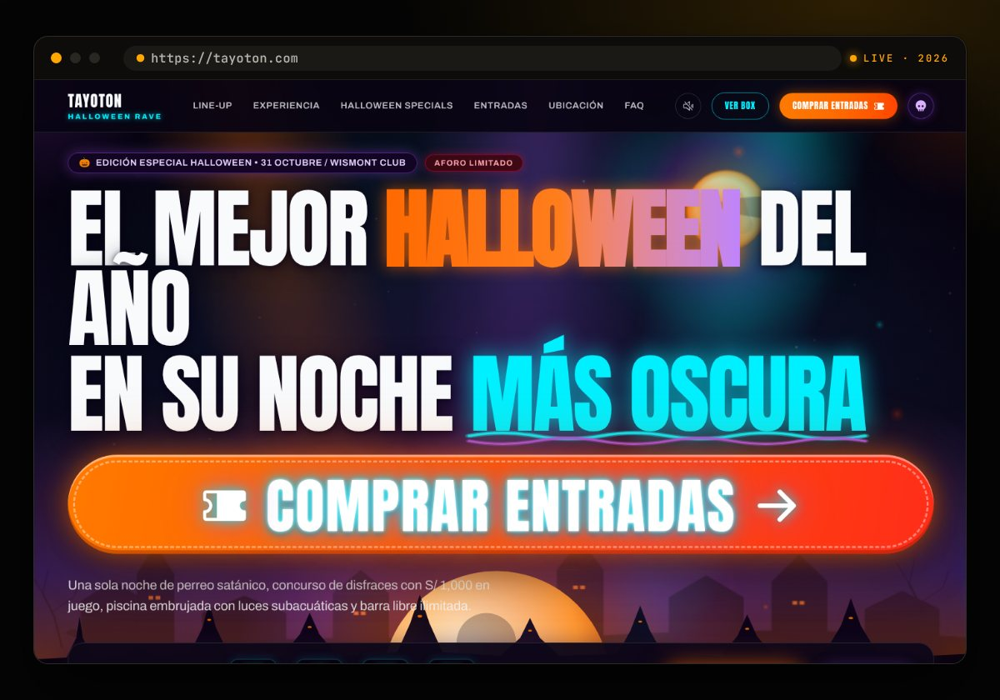</a>
<h3>Tayoton Fest <sub><sup>2026</sup></sub></h3>
Music festival — ticketing, event SEO and Google Ads, built &amp; positioned by Cernext.<br/><br/>
<code>Ticketing</code> <code>SEO</code> <code>Google Ads</code>
</td>
<td width="50%" valign="top">
<a href="https://www.maxgrind.app/es">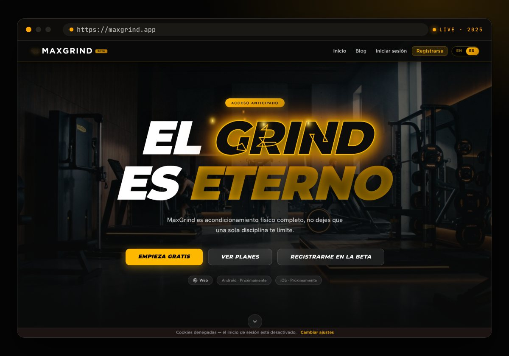</a>
<h3>MaXGrind <sub><sup>beta</sup></sub></h3>
MMA &amp; strength-training tracker — moving from web to native mobile.<br/><br/>
<code>React Native</code> <code>Expo</code> <code>Supabase</code> <code>PostgreSQL</code>
</td>
</tr>
<tr>
<td width="50%" valign="top">
<a href="https://jhefbarberz.vercel.app/">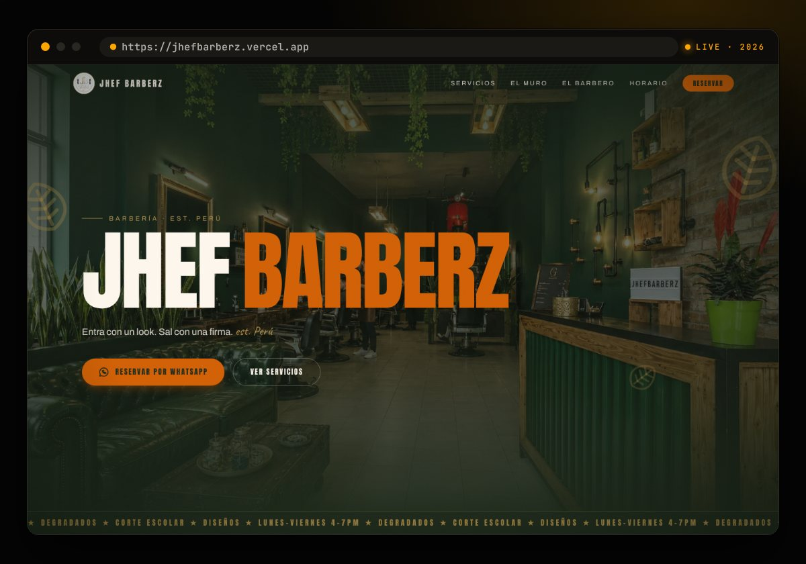</a>
<h3>JHEF Barberz <sub><sup>2026</sup></sub></h3>
Barbershop brand site with smooth-scroll storytelling and WhatsApp booking.<br/><br/>
<code>Next.js 15</code> <code>TypeScript</code> <code>Tailwind v4</code> <code>Framer Motion</code> <code>Lenis</code>
</td>
<td width="50%" valign="top">
<a href="https://lyfgolosinas.com">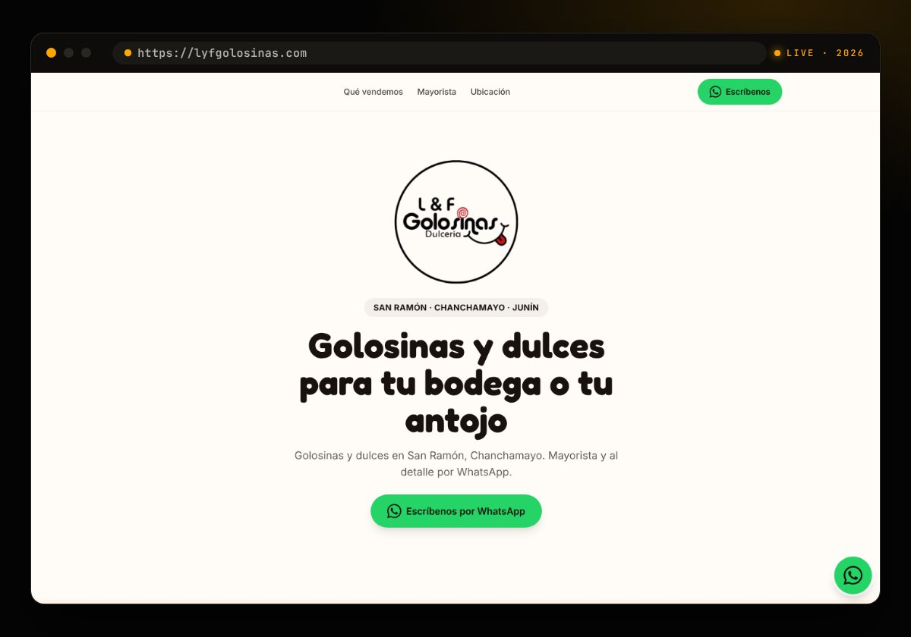</a>
<h3>L&amp;F Golosinas <sub><sup>2026</sup></sub></h3>
Candy &amp; sweets wholesaler in Chanchamayo — catalog landing that closes on WhatsApp.<br/><br/>
<code>Next.js</code> <code>Tailwind</code> <code>Local SEO</code> <code>WhatsApp</code>
</td>
</tr>
<tr>
<td colspan="2" align="center">
<br/>
<a href="https://barclayleach.com/en/portfolio/"></a>
<br/><br/>
<sub>Also shipped: <a href="https://aguxtin.com">Aguxtin</a> (scrollytelling · Next.js + GSAP) · Highland Coffee · Inkapos · Zent Piper · Gamarrita POS · Baratísimo Perú · Wismont Club · El Hada Artesana</sub>
<br/><br/>
</td>
</tr>
</table>

<br/>

<p align="center">
  <picture>
    <source media="(prefers-color-scheme: dark)" srcset="./assets/headings/h-stack-dark.svg">
    
  </picture>
</p>

<div align="center">

<sub><b>FRONTEND</b></sub><br/>


<sub><b>BACKEND · DATA · INFRA</b></sub><br/>


<sub><b>MOTION · MOBILE · GROWTH</b></sub><br/>


</div>

<br/>

<p align="center">
  <picture>
    <source media="(prefers-color-scheme: dark)" srcset="./assets/headings/h-credentials-dark.svg">
    
  </picture>
</p>

| Credential | Issuer | Issued | Verify |
|------------|--------|:------:|:------:|
| **Full-Stack Development Career** · 106 h | Coderhouse | Jun 2026 | — |
| **Backend III: Testing & Scalability** · 30 h | Coderhouse | Jun 2026 | [↗](./assets/certs/coderhouse-backend-iii.pdf) |
| **Backend II: Design & Architecture** · 16 h | Coderhouse | Apr 2026 | [↗](https://pub.coderhouse.com/certificates/50e5570d-773a-44dd-a0b6-f32133ecbc5a) |
| **TPMAR Interpretation Training** | Teleperformance | Apr 2026 | — |
| **Backend I: Advanced Backend Development** · 18 h | Coderhouse | Jan 2026 | [↗](https://pub.coderhouse.com/certificates/6abda41a-761b-41ae-97f8-6cc4e32fc560) |
| **React JS** · 16 h | Coderhouse | Nov 2025 | [↗](https://pub.coderhouse.com/certificates/7c6a7711-72cb-4aa8-a5ef-9c3bf1e8c66a) |
| **JavaScript** · 20 h | Coderhouse | Sep 2025 | [↗](https://pub.coderhouse.com/certificates/f7bee214-30c2-48c0-9be5-63c3cbd177fe) |
| **Advanced Search Engine Optimization** | Universidad Continental | Sep 2025 | [↗](https://v.pok.tech/r/84b07799-a349-42b6-b553-41fefb52f3e9) |
| **Git & GitHub** · 6 h | Alura Latam · Oracle ONE | Aug 2025 | [↗](https://app.aluracursos.com/certificate/2d6ac7c9-40ef-4718-be87-41bca97170c2) |
| **Web Development** · 38 h | Coderhouse | Jul 2025 | [↗](https://pub.coderhouse.com/certificates/3c2046d4-15b8-4b07-be7d-cb9b800c0b02) |

<div align="center">
<sub>Full list with credential IDs on <a href="https://www.linkedin.com/in/barclay-leach/details/certifications/">LinkedIn</a> · CV at <a href="https://barclayleach.com/en/cv/">barclayleach.com/en/cv</a></sub>
</div>

<br/>

<p align="center">
  <picture>
    <source media="(prefers-color-scheme: dark)" srcset="./assets/headings/h-beyond-dark.svg">
    
  </picture>
</p>

<p align="center">
  
</p>

<br/>

<p align="center">
  <picture>
    <source media="(prefers-color-scheme: dark)" srcset="./assets/headings/h-telemetry-dark.svg">
    
  </picture>
</p>

<div align="center">


<br/><br/>

<picture>
  <source media="(prefers-color-scheme: dark)" srcset="https://raw.githubusercontent.com/BclayDrius/BclayDrius/output/snake-dark.svg">
  
</picture>

</div>

<br/>

<p align="center">
  <a href="https://barclayleach.com/en/"></a>
</p>
